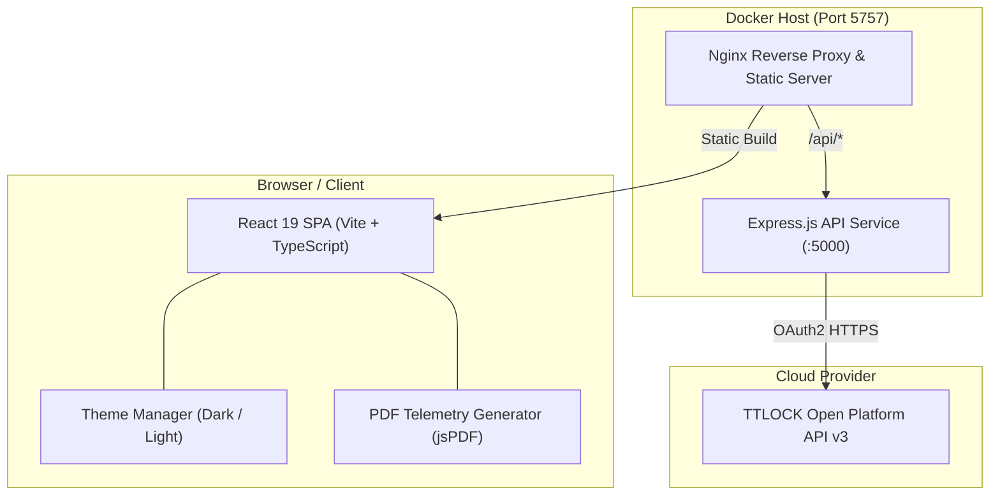

# TTLOCK Dashboard

A modern web application for **real-time monitoring, hardware telemetry, and fleet operations** of TTLOCK Smart Locks and WiFi Gateways. Features real-time lockbox statuses, unlock logs, interactive gateway topology mapping, offline passcode generation, remote unlocking, and client-side hardware diagnostics PDF export.

[](CHANGELOG.md)
[](LICENSE)
[](docker-compose.yml)
[](https://github.com/helmipradita/ttlock-dashboard/pkgs/container/ttlock-backend)
[](web/)
[](backend/)
[](web/tsconfig.json)

---

## 📑 Table of Contents

- [Key Features](#-key-features)
- [System Architecture](#-system-architecture)
- [Quick Start Guide](#-quick-start-guide)
- [Detailed Documentation](#-detailed-documentation)
- [API Endpoints](#-api-endpoints)
- [Sponsors & Backers](#-sponsors--backers)
- [License](#-license)

---

## ✨ Key Features

- 🔑 **Offline One-Time Passcode**: Instantly generate 6-hour temporary PINs using TTLOCK's algorithmic time-sync architecture without requiring gateway internet connectivity.
- 🔓 **Remote Unlock**: Execute remote unlocks instantly via connected online WiFi Gateways.
- 📄 **Hardware Diagnostics PDF Export**: Export comprehensive A4 hardware telemetry reports with one click using `jspdf` (lazy-loaded). Highlights offline gateways, weak signal rankings (< -85 dBm), low batteries, and unlinked units.
- 📡 **Live Signal Telemetry & Stale Detection**: Real-time RSSI signal quality mapping per lockbox. Automatically transitions to `GW Offline` / `GW Down` if the gateway disconnects. Telemetry snapshots older than 15 minutes display an amber clock icon with timestamp tooltips.
- 🚦 **Fleet Triage Filters**: Fast-filter lockbox inventories by operational criteria: *All*, *Needs Attention*, *Weak Signal*, *No Gateway*, *Battery ≤ 20%*, and *Connected*.
- 🌐 **Interactive Gateway Topology**: Dynamic Canvas graph illustrating Gateway $\leftrightarrow$ Lockbox relationships with live/offline edge animations, RSSI indicators, and interactive pan/zoom/drag controls.
- 🔍 **Smart Autocomplete Search**: High-speed lock lookup powered by a lightweight `/api/locks` endpoint, keyboard shortcuts (`/` or `Ctrl+K`), and matching across Lock ID, Name, and Alias.
- 🌓 **Dark & Light Themes**: Auto-detects system OS theme preferences with a manual switcher persisted in `localStorage`.
- ⚡ **Fail-Fast Configuration**: Strict startup validation for `TTLOCK_*` environment credentials to prevent silent background failures.
- 🔄 **Autonomous Token Lifecycle**: Automated OAuth2 token refresh 24 hours prior to expiration with zero manual intervention.

---

## 📐 System Architecture



For comprehensive data flow diagrams, sequence flows, and component hierarchies, refer to the [Architecture Documentation](docs/ARCHITECTURE.md).

---

## 🚀 Quick Start Guide

Choose the method that best matches your workflow:

### 📦 Option 1: Run Pre-Built Container Images (No Source Clone Required)

Ideal for operators running the dashboard directly on local workstations or production servers.

1. Create a `docker-compose.yml` file in any directory:
   ```yaml
   services:
     backend:
       image: ghcr.io/helmipradita/ttlock-backend:latest
       environment:
         - TTLOCK_CLIENT_ID=your_client_id
         - TTLOCK_CLIENT_SECRET=your_client_secret
         - TTLOCK_USERNAME=your_ttlock_email@example.com
         - TTLOCK_PASSWORD_MD5=your_md5_password
         - PORT=5000
       expose:
         - "5000"
       restart: unless-stopped

     web-nginx:
       image: ghcr.io/helmipradita/ttlock-web-nginx:latest
       ports:
         - "5757:5757"
       depends_on:
         - backend
       restart: unless-stopped
   ```

2. Start the containers:
   ```bash
   docker compose up -d
   ```

3. Access the dashboard in your browser at **`http://localhost:5757`**.

---

### 💻 Option 2: Run from Source Code (Clone Repository)

Ideal for developers customizing or extending the codebase.

```bash
# 1. Clone repository
git clone https://github.com/helmipradita/ttlock-dashboard.git
cd ttlock-dashboard

# 2. Configure environment credentials
cp backend/.env.example backend/.env
# Populate TTLOCK_CLIENT_ID, TTLOCK_CLIENT_SECRET, TTLOCK_USERNAME, and TTLOCK_PASSWORD_MD5 in backend/.env

# 3. Build and launch services
docker compose up -d --build

# 4. Open browser
# http://localhost:5757
```

> **Build Tip:** You **do not need** to execute `npm run build` locally before running `docker compose up`. The Dockerfiles leverage multi-stage container builds and `.dockerignore` filters for optimal compilation.

---

## 📚 Detailed Documentation

Detailed operational guides and technical specifications are available in the `docs/` directory:

| Document | Description |
|---|---|
| 📐 [**System Architecture**](docs/ARCHITECTURE.md) | Module interactions, sequence flows for passcodes and telemetry, and container topology. |
| 🛠️ [**Tech Stack Specifications**](docs/TECH_STACK.md) | In-depth breakdown of frontend, backend, PDF reporting, and third-party libraries. |
| 🔌 [**API Reference**](docs/API_REFERENCE.md) | Internal REST API schemas, request/response contracts, and TTLOCK error mappings. |
| 🚀 [**Deployment Guide**](docs/DEPLOYMENT.md) | Environment configuration, container memory allocations, and troubleshooting checklists. |
| 📋 [**Changelog**](CHANGELOG.md) | Release history, feature additions, and bug fixes per version. |

---

## 🔌 API Endpoints

| Method | Endpoint | Description |
|---|---|---|
| `GET` | `/api/auth/status` | Verify active TTLOCK OAuth2 token authentication status |
| `GET` | `/api/locks/enriched` | Retrieve all lockboxes enriched with real-time `lastOpen`, RSSI, and gateway status |
| `GET` | `/api/locks` | Fast lightweight lockbox query for search autocomplete |
| `GET` | `/api/locks/:lockId` | Retrieve technical specifications for a single lockbox |
| `GET` | `/api/locks/:lockId/records` | Retrieve paginated unlock record history |
| `GET` | `/api/locks/:lockId/gateway` | Retrieve connected gateway details and signal strength |
| `POST` | `/api/locks/:lockId/passcode` | **Generate algorithmic offline One-Time Passcode (valid 6 hours)** |
| `POST` | `/api/locks/:lockId/unlock` | **Dispatch remote unlock command via connected WiFi Gateway** |
| `GET` | `/api/gateways` | Retrieve list of all registered gateways |
| `GET` | `/api/gateways/:gatewayId/topology` | Retrieve Gateway $\leftrightarrow$ Lockbox topology (cached for 30 seconds) |

---

<a id="sponsors"></a>
<a id="sponsors--backers"></a>
## 💖 Sponsors & Backers

This project is supported by open-source programs:

<table>
  <tr>
    <td align="center" width="220">
      <a href="https://termius.com/" target="_blank" rel="noopener noreferrer">
        <picture>
          <source media="(prefers-color-scheme: dark)" srcset="https://raw.githubusercontent.com/helmipradita/ttlock-dashboard/main/.github/assets/termius-logo-white.png" />
          
        </picture>
      </a>
    </td>
    <td>
      <a href="https://termius.com/" target="_blank" rel="noopener noreferrer"><strong>Termius</strong></a> provides a secure, reliable, and collaborative SSH client and terminal console across desktop and mobile devices.
    </td>
  </tr>
</table>

---

## 📄 License

This project is open-source software licensed under the [**MIT License**](LICENSE).

Copyright (c) 2026 Helmi Pradita.
