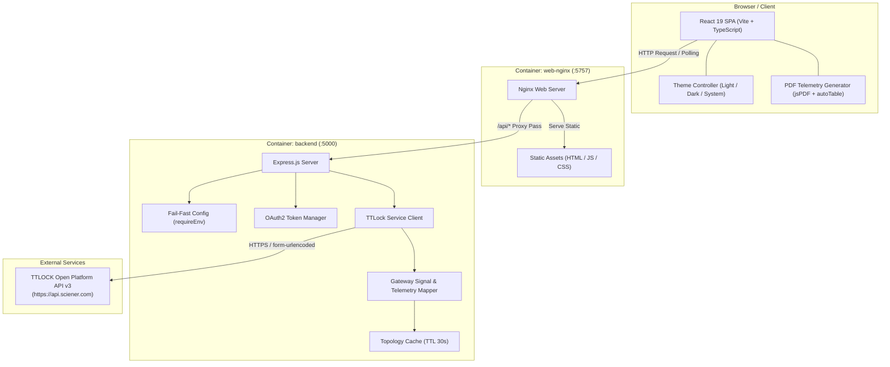
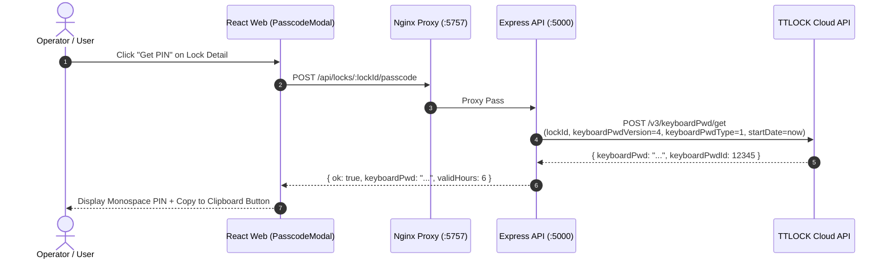
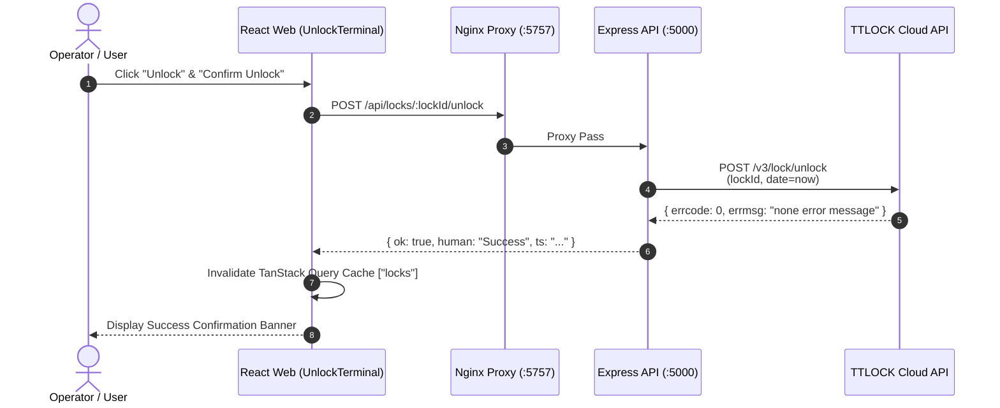
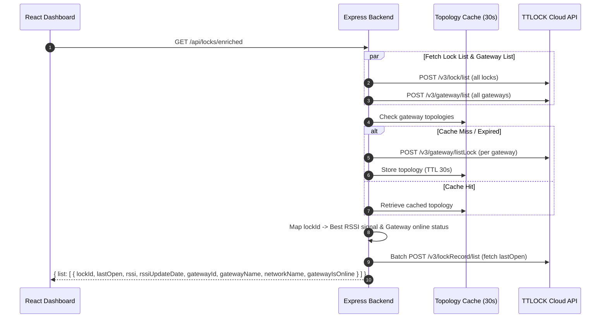
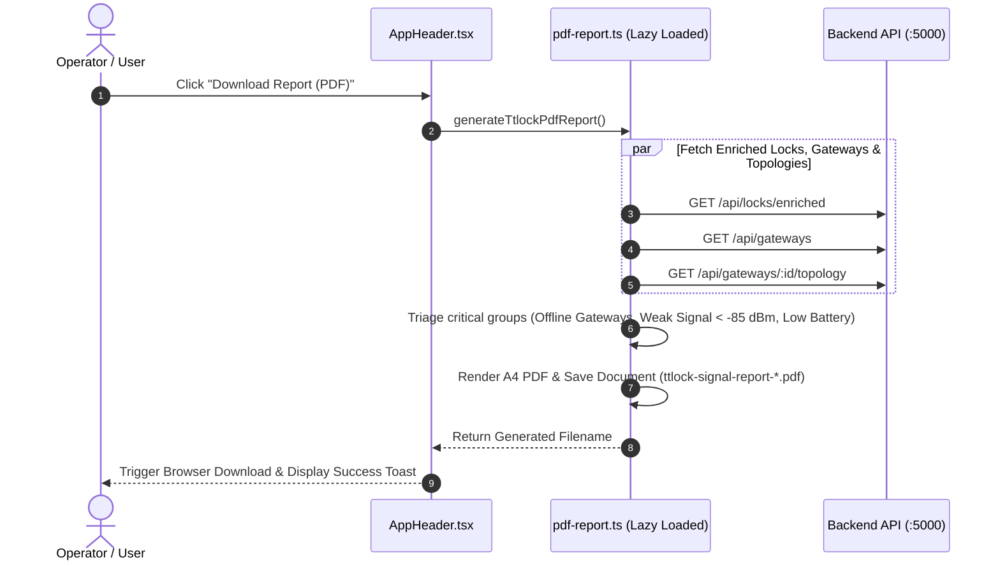
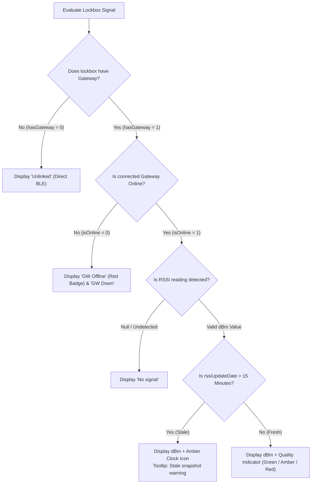
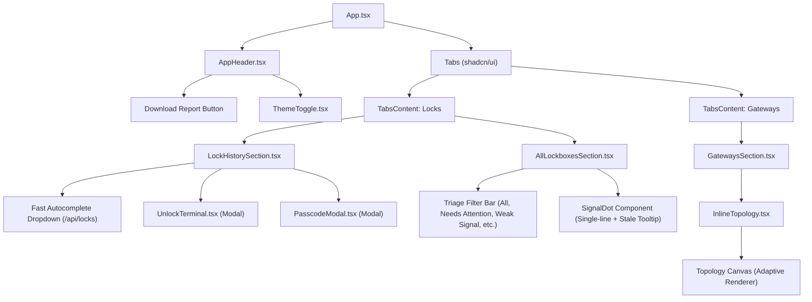

# TTLOCK Dashboard — System Architecture

This document outlines the software architecture, data flow sequences, frontend component hierarchy, and container deployment model for **TTLOCK Dashboard**.

---

## 1. Overall System Architecture

The application adopts a **Single Page Application (SPA)** model served by an Nginx reverse proxy and static asset server, interfaced with an Express.js backend that acts as an API gateway to the TTLOCK Open Platform API v3.

---

## 2. Data Flow & Sequence Diagrams

### A. One-Time Offline Passcode Generation Flow
Passcodes are computed algorithmically based on shared time synchronization between TTLOCK servers and physical lockbox firmware. **No gateway internet connectivity is required.**

---

### B. Remote Unlock Command Flow
Requires the lockbox to be connected to an Online WiFi Gateway, with the *Remote Unlock* feature enabled in TTLOCK lock settings.

---

### C. Signal Telemetry & Enriched Lockbox Aggregation (`/api/locks/enriched`)
Aggregates the strongest RSSI reading per lockbox across all gateways in parallel, prioritizing online gateways, and capturing scan timestamps (`rssiUpdateDate`).

---

### D. Hardware Diagnostics Telemetry PDF Export Flow
Client-side PDF generation using `jspdf` and `jspdf-autotable`. Libraries are lazy-loaded on demand to preserve optimal initial application bundle size.

---

### E. Signal Logic & Stale Reading Evaluation Flow

---

## 3. Frontend Component Hierarchy

---

## 4. Container Architecture & Resource Model

The application is deployed as two lightweight Docker containers:

| Service | Base Image | Internal Port | Exposed Port | Role & Responsibility |
|---|---|---|---|---|
| **`web-nginx`** | `nginx:alpine` | 5757 | **5757** | Serves static React production bundle & reverse-proxies `/api/*` to backend. |
| **`backend`** | `node:22-alpine` | 5000 | *Not directly exposed* | Express API server, OAuth2 manager, telemetry aggregator, and TTLOCK client. |
